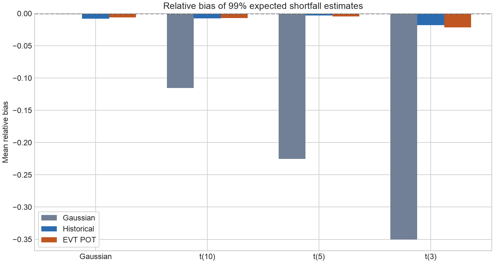
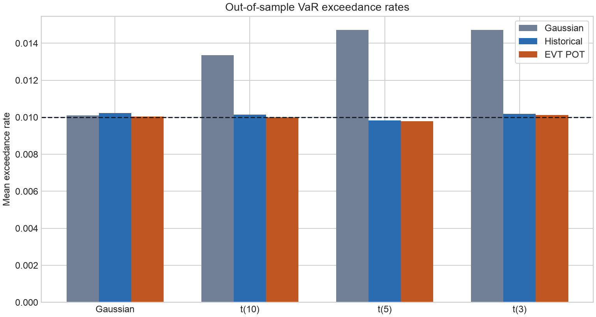

# Tail Risk Model Backtesting Lab

[](https://github.com/lcx0731/tail-risk-model-backtesting-lab/actions/workflows/test.yml)

A reproducible out-of-sample audit of 99% Value at Risk (VaR) and expected shortfall
(ES) estimators under progressively heavier tails.

## Models

- **Gaussian:** sample mean and standard deviation with normal-tail formulas.
- **Historical:** empirical 99th percentile and mean loss beyond that percentile.
- **EVT POT:** generalized Pareto fit to losses above the empirical 90th percentile,
  extrapolated to the 99% tail.

## Simulation design

Synthetic losses have zero mean and unit variance under four distributions: Gaussian
and Student-t with 10, 5, or 3 degrees of freedom. For each of 250 replications per
scenario, models fit 2,000 calibration losses and are evaluated on an independent
5,000-loss test set. Analytical VaR and ES provide a known benchmark.

The audit reports relative VaR and ES bias, out-of-sample exceedance rate, quantile
pinball loss, and how often the Kupiec unconditional-coverage test rejects at 5%.
All data are deterministic synthetic draws; no market data or private data are used.

## Reproduce

```bash
python -m venv .venv
source .venv/bin/activate
python -m pip install -e ".[test]"
pytest -W error
python -m tail_risk_model_backtesting_lab --output-dir artifacts
```

## Results

The Gaussian model is well calibrated when the data are Gaussian, but its thin-tail
assumption becomes increasingly optimistic as tail thickness increases. Under the
unit-variance t(3) scenario it underestimates 99% VaR by 12.5% and ES by 35.0%; its
mean exceedance rate is 1.47% instead of the 1% target.

Historical and EVT estimates remain much closer to the analytical tail risk across
the Student-t scenarios. For t(3), historical/EVT VaR relative bias is +0.60%/+0.42%,
ES relative bias is -1.82%/-2.18%, and mean exceedance rates are 1.019%/1.012%.
EVT has the lowest mean pinball loss in each heavy-tail scenario, although the gaps
are small and this experiment does not imply universal model superiority.

Coverage-test rejection is higher than the nominal 5% even for correctly specified
models because each forecast is estimated from a finite 2,000-observation calibration
sample while the standard Kupiec reference treats the forecast as fixed. The metric
is therefore used here as a comparative stability diagnostic, not a size-corrected
hypothesis test for estimated models.





## Outputs

- `artifacts/simulation_results.csv`: estimator bias, exceedance, pinball, EVT shape,
  and Kupiec rejection summaries.
- `artifacts/run_summary.json`: machine-readable design and headline results.
- `artifacts/var_bias.png`: relative VaR bias by tail thickness.
- `artifacts/es_bias.png`: relative expected-shortfall bias.
- `artifacts/exceedance_rate.png`: realized tail exceedance against the 1% target.
- `artifacts/kupiec_rejections.png`: coverage-test rejection frequency.

## Repository structure

```text
src/tail_risk_model_backtesting_lab/
  distributions.py  # standardized loss generators and analytical truth
  models.py         # Gaussian, historical, and EVT estimators
  backtesting.py    # pinball loss and Kupiec coverage test
  evaluation.py     # independent calibration/test Monte Carlo audit
  reporting.py      # static bias and coverage figures
tests/               # distribution, estimator, backtest, and E2E tests
artifacts/           # reproducible outputs from the default run
```

## Limitations

- Losses are independent and identically distributed; volatility clustering and
  serially dependent exceedances are out of scope.
- EVT uses a fixed 90% threshold. Real threshold choice needs stability diagnostics.
- Historical ES is noisy because only about 20 calibration observations lie beyond
  the 99% empirical VaR.
- Kupiec tests unconditional coverage only and does not test violation independence.
- Results depend on calibration and test sample sizes and do not establish universal
  superiority of one model.

## Responsible use

This repository is for education and portfolio demonstration only. It is not
investment advice, a trading system, or a production risk-management model.
